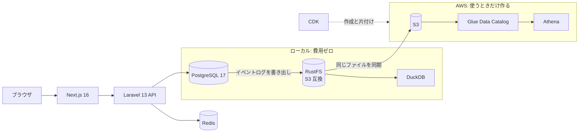

<!--
下書き（docs/article-series.md 1-0）。Qiita には「## はじめに」から下を貼る。# の行は Qiita のタイトル欄に入れる。
TODO の箇所は自分の言葉に置き換える。公開前に article-series.md の「公開前チェック」を通す。
題名・タグは docs/articles/README.md で管理する。
-->

# ゴール裏年パス勢が、架空スタジアムのチケットサイトを作る理由 ― 架空サカスタのチケットサイトで学ぶ（0）

## はじめに

架空のサッカースタジアム「ペヌソニックスタジアム（通称ペヌスタ）」のチケット販売サイトを、遊び場として作っています。
ちゃんと動くチケットサイトを土台に、販売方式の実験やデータ分析（AWS 認定 Data Engineer / Machine Learning Engineer の学習）へ広げていくのが目的です。

この記事はシリーズの紹介回です。

- なぜ架空スタジアムのチケットサイトを、遊び場として作るのか
- ペヌスタはどういう世界か
- 遊び場として、どういう方針で作っているか
- 技術構成と、今できていること
- このシリーズでこの先書くこと

## なぜ作るのか

### なぜサッカースタジアムか

一言でいうと、サイトが「どう動けばいいか」も、「何が分析の対象になりそうか」も、なんとなく想像できるからです。

ずっとサッカーをやってきましたし、観る側としても長くファンをしています。
アーセナルは 2013-14 シーズンから応援していて、グーナー歴は 13 年になりました。
ガンバ大阪は、うっすら好きだった時期を含めると 20 年以上。ゴール裏に通い始めて 1 年ちょっとで、今はゴール裏の年パスを持っています。

チケットを買う側として慣れ親しんだ世界なので、この経験を活かせば、色々な分析ができておもしろいのではと考えました。
あとは単純に、チケットの裏側がどうなっているかに興味があります。

たとえばパナスタ（パナソニックスタジアム吹田）でチケットを買っていると、こんなことが見えてきます。

- アウェー席の数は、相手チームによって違う
- 価格は試合ごとに変わる（ダイナミックプライシング）
- ホームとアウェーのサポーターの間は空けてある。日本では一部を除いて衝突は起こりにくいものの、起こりうる以上、席の配置で備えておく必要がある

どれも、このサイトの機能や分析の題材にそのまま使っています。
アウェー席の数は試合ごとの割当（1-1）、価格は動的価格（第 3 部）、空けてある席は緩衝帯です。

緩衝帯には正解がありません。
長崎のピーススタジアムは、アウェー側ゴール裏の一部をビジター席にし、その隣をホーム・アウェーどちらのグッズも身につけられる席にしています。
空席の緩衝帯は置かず、さらにゴール裏の一部を「変動エリア」として、売れ行きに応じてビジター席にも普通の席にもできるようにしています。
空席を作らずに売れる席を増やす、うまいやり方だと思います。

ただ、境目の席では大きな旗を振れないなど、ビジター席とはルールが違います。
アウェーのサポーターが境目を越えて応援し、警備員が入って揉めた、という話も耳にします。
トラブルを起こさず、それでいて売上や動員数も確保する。緩衝帯をどれだけ空けるかは、この 2 つの釣り合いで決まります。
この釣り合いを分析して、緩衝帯の境界を動かせるようにするのも、このサイトで遊びたいことの 1 つです。

<!-- ピーススタジアムの席割りとグッズのルールは 2026-27 シーズンの公式サイトで確認（https://www.v-varen.com/tickets_new/ 、https://www.v-varen.com/rule/ ）。揉めた話は報道では見つからず、伝聞のまま。公開前に URL を見直す -->

### なぜ架空か

実在のクラブやスタジアムをそのまま使うのはなんだか気が引けたので、舞台は架空にしました。深い理由はありません。

### なぜ遊び場か

業務と別に遊び場を作ったのは、業務では扱わない・扱えない技術や知識に手を出したかったからです。
理由の大半は知的好奇心で、それが業務やこの先のキャリアにつながったら儲けもの、くらいに考えています。

## ペヌスタという世界

ペヌスタは、4 つのスタンド（メイン / バック / 北 / 南）を持つ約 20,000 人のサッカー専用スタジアムです。
モデルはパナスタ、つまりガンバ大阪のホームスタジアムで、約 4 万人入る実物の規模を半分にしました。

| スタンド | 席 | 人数 |
|---|---|---|
| メイン・バック | 指定席（1 席ずつ売る） | 12,000 |
| 北・南（ゴール裏） | 自由席（ブロックの定員まで売る） | 8,000 |

ホームクラブは架空の「ペヌスタFC」（仮の名前です）。
モデルがモデルなので、ここから先のぼやきにはガンバが出てくるかもしれません。

サッカーのチケットらしく、試合ごとにブロックを「ホーム」「アウェー」「緩衝帯（両サポーターの間を空ける）」に割り当てます。
人気のある相手との試合では、アウェー席を広げます。

## 7 シーズン分の成績シナリオ

分析の素材にするため、ペヌスタFC には 7 シーズン分の「歴史」を持たせました。

| シーズン | 形式 | ペヌスタFC の成績 |
|---|---|---|
| 2021 | 春秋制（2 月〜12 月） | 16 位でなんとか残留（降格争い） |
| 2022〜2024 | 同上 | 12 位 / 12 位 / 8 位（中位） |
| 2025 | 同上 | 2 位。終盤に首位の時期もあったが、タイトルには届かず |
| 2026 ハーフ | 2〜6 月の特別大会（昇降格なし） | グループ 5 位 |
| 2026-27 | 秋春制（8 月開幕、冬は中断） | 序盤を終えて 9 位（出遅れ） |

降格争いからタイトル争いへ駆け上がり、秋春制への移行をまたぐ 7 シーズンです。
ハーフシーズンや秋春制への移行は J リーグの実際の流れに合わせましたが、成績はガンバの実際の歩みではなく、願望込みです。
（こんな世界線だったらよかったのに。笑）
<!-- TODO: 番外 X-4 を出したらリンク -->

ホーム戦は合計 123 試合あり、試合ごとに相手・曜日・天気・価格が決まっています。

チケットの売れ行きは、乱数で適当に作ってはいません。
成績、相手の人気、曜日、天気、価格によって需要が変わるように仕込んであります。
たとえば「優勝争いの終盤はどの席がどれだけ売れたか」「雨の日は何が変わるか」を分析すると、仕込んだ答えが出てくるはずです。

:::note info
仕込んだ式は、データ分析の回（第 2 部）で答え合わせに使うため、ここでは書きません。
:::

ちなみに、2026 年はハーフシーズンと秋春制の 2 シーズンにまたがり、秋春制では「11 月 = シーズン終盤」が成り立ちません。
暦年や月で区切って集計すると結果がおかしくなる、という落とし穴も入っています。これも分析の回で扱います。

## 遊び場としての設計方針

最初に 4 つの方針を決めました。どれも「後で遊ぶ」ための仕込みです。

### 1. スタジアムの構造はデータで持つ

スタンド → ブロック → 席をマスタデータにし、ホーム / アウェーの割当は「試合 × ブロック」の属性にしました。
座席図もこのデータから描くので、ブロックや配置を変えてもフロントのコードを触らずに済みます。
詳しくは次回（1-1）で扱います。

### 2. イベントログを最初から吐く

閲覧、カート、購入といった行動を、最初から append-only のイベントとして記録しています。
後から分析したくなっても、ログがなければ何も始まらないからです。
ログは日付ごとのフォルダ（`dt=2026-10-11/` のような形）に分けて S3 互換のストレージへ書き出すので、ローカルで試したファイルをそのまま AWS に持っていけます。

### 3. 販売方式は差し替えられるようにする

先着、抽選、waiting room（購入画面に入る前の待ち行列）のように、販売方式を後から差し替えて比べられる形にしています。
今は先着だけです。

### 4. 合成データには答えを仕込む

前の節のとおり、合成データは分析すると答えが出るように作っています。
本物の販売データは手に入らないので、「答えが分かっているデータ」で分析の腕を確かめる、という割り切りです。

## 技術構成

開発環境は Docker Compose でまとめています。

| 部品 | 選んだ理由 |
|---|---|
| Laravel（API）+ Next.js | 使ったことがあり、業務でも使いうる |
| PostgreSQL | ウィンドウ関数や JSONB など分析向きの機能があり、Redshift（PostgreSQL 系の方言）とも相性がよい。業務とは別の DB を触る狙いもある |
| RustFS + DuckDB | S3 互換のストレージと SQL エンジンをローカルに置き、費用ゼロで分析を試す |
| AWS（S3 / Glue / Athena） | 本番相当の分析基盤。CDK で作り、使い終わったら片付ける。常時課金のサービスは使わない |

アプリ側は、深く考えずに使ったことのある技術にしました。
このシリーズの主役はハコの上でやる分析や実験なので、ハコまで新しい技術で冒険すると軸がぶれそうだと思ったからです。
新しいバックエンドを試すのは、このハコではなく、別の個人開発でやるつもりです。

## 今できていること

- 試合一覧 → 座席図 → 席を選んで仮押さえ → 購入手続き → 決済（モック）→ 完了
- 二重販売の防止（指定席はユニーク制約、自由席は定員のカウント）と、仮押さえの期限切れ
- 管理画面で、試合ごとのホーム / アウェー / 緩衝帯を座席図の上で塗り替える
- イベントログを RustFS に書き出し、DuckDB でファネル（閲覧 → カート → 購入）を集計する
- 同じファイルを S3 に置き、Athena で集計する。Iceberg テーブルの MERGE やタイムトラベルも試した

<!-- TODO: スクリーンショット（Qiita の編集画面にドラッグ&ドロップで貼る）。候補: 試合の座席図（http://localhost:3100）、管理画面の割当エディタ（/admin）。画像の下に 1 行の説明を付ける -->

*購入側の座席図。ブロックの色は割当（ホーム / アウェー / 緩衝帯）で、売れているブロックほど薄くなる*

*管理画面の割当エディタ。座席図の上でブロックを塗り、試合ごとの割当を変える*

※どちらも開発中の画面です。見た目はまだ何も作り込んでいません（UI の作り込みも、この先の遊びの 1 つです）

合成データの規模は次のとおりです。

| 試合 | ユーザー | 注文 | チケット | イベント |
|---|---|---|---|---|
| 123 | 9 万 | 81 万 | 145 万 | 603 万 |

まだできていないこと: ログイン（今は開発用のユーザー切替だけ）、販売フェーズ（年パス先行 / FC 先行 / 一般）、抽選販売、waiting room、需要予測と動的価格。

## このシリーズで書くこと

同じシステムとデータで、構築 → データ基盤 → 分析 → 予測まで通します。

| 部 | 内容 |
|---|---|
| 第 1 部: ハコを作る | スタジアム構造のテーブル設計、Docker での開発環境、座席図と購入フロー（仮押さえ・二重販売の防止）、管理画面と検証の仕組み、イベントログと合成データ |
| 第 2 部: データ分析 | イベントログを S3 へ、CDK で Glue / Athena を組む、パーティションや形式でスキャン量はどれだけ変わるか、Iceberg、データ品質、権限設計、取り込みの自動化 |
| 第 3 部: 機械学習 | 需要予測、動的価格、データのドリフトを検知できるか |
| 番外 | 開発の進め方、同時実行制御の比較（DB のロックと Redis）、資格の受験記 など |

第 2 部と第 3 部は、資格の学習と並行して書きます。

## 作り方について

このシステムは、Claude Code に役割ごとのサブエージェント（探索、実装、検証、レビュー）を分担させて作っています。
どう分担させ、どこで人が判断しているかは、番外編で書く予定です。
記事の骨格も Claude Code に作らせ、自分の言葉で書き直しています。
設計判断は自分で説明できるものだけを書き、記事中のコマンドや数値は手元で実行して確かめています。

## おわりに

次回は、ペヌスタの座席をどうテーブルで表したか（スタンド → ブロック → 席と、割当のテンプレート）を書きます。

<!-- TODO: シリーズの他の回へのリンク -->
