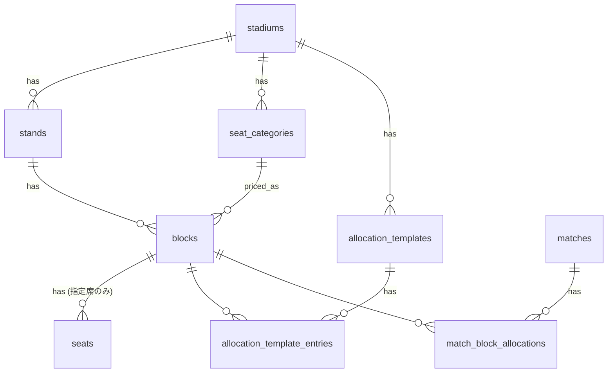

<!--
下書き（1-1）。Qiita には「## はじめに」から下を貼る。# の行は Qiita のタイトル欄に入れる。
TODO の箇所は自分の言葉に置き換える。公開前にシリーズの構成メモ（非公開）の「公開前チェック」を通す。
題名・タグは docs/articles/README.md で管理する。
-->

# スタジアムの座席をどうテーブルにするか ― 架空サカスタのチケットサイトで学ぶ（1）

## はじめに

架空のサッカースタジアム「ペヌソニックスタジアム（通称ペヌスタ）」のチケット販売サイトを、遊び場として作っています。
なぜ作っているのか、全体がどうなっているのかは紹介回に書きました。

ゴール裏年パス勢が、架空スタジアムのチケットサイトを作る理由 ― 架空サカスタのチケットサイトで学ぶ（0）
https://qiita.com/macchi23/items/5b9f5670c841f5c41be8

この記事では、最初に決めた「スタジアムの構造をどうテーブルで表すか」を扱います。

- 指定席と自由席を、同じテーブルでどう扱うか
- ホーム / アウェーの割当を、試合ごとにどう持つか
- 割当のテンプレートを、試合に「コピー」するか「参照」するか

構成は Laravel（API）+ Next.js + PostgreSQL です。

## スタジアムの構造

ペヌスタはこういう構造にしました。

| スタンド | ブロック | 席の種類 | 席種（価格帯） |
|---|---|---|---|
| メイン | M1〜M12 | 指定席（各 500 席 = 25 列 × 20 番） | 中央の M5〜M8 がカテゴリー1、それ以外がカテゴリー2 |
| バック | B1〜B12 | 指定席（各 500 席） | カテゴリー3 |
| 北（ホームゴール裏） | N1〜N16 | 自由席（各 250 人） | ゴール裏 |
| 南 | S1〜S16 | 自由席（各 250 人） | ゴール裏 |

指定席 12,000 席 + 自由席 8,000 人の計 20,000 人です。
タッチライン側（メイン・バック）が 60%、ゴール裏が 40% になるようにしました。

モデルはパナソニックスタジアム吹田（パナスタ）で、約 4 万人入る実物の規模を半分にしています。

:::note
余談ですが、パナスタは本当にいいスタジアムです。
初めて行ったときは、ガンバサポーターの雰囲気も相まって「ここ日本じゃねぇ、イングランドかドイツ、イタリアあたりだろ」と本気で思いました。
:::

### 最初は 7,200 人だった

実は最初の構成は、今とだいぶ違いました。

| | 最初 | 今 |
|---|---|---|
| メイン・バック | 指定席 200 席 × 16 ブロック = 3,200 | 指定席 500 席 × 24 ブロック = 12,000 |
| ゴール裏 | 自由席 500 人 × 8 ブロック = 4,000 | 自由席 250 人 × 32 ブロック = 8,000 |
| 計 | 7,200（ゴール裏が 56%） | 20,000（ゴール裏が 40%） |

作り直した理由は 3 つです。

- **そもそも比がおかしい**: サッカー専用スタジアムは、タッチライン側のほうが席が多いのが普通。ゴール裏が半分以上はさすがにない
- **席が少ない**: 7,200 人では、完売や需要の差を見るにはこぢんまりしすぎている。もう少し規模がほしかった
- **緩衝帯の幅を変えられない**: ゴール裏が 1 ブロック 500 人だと、緩衝帯は 1 ブロック置くだけで 500 人分が空く。相手との危険度に応じて「今日は 1 ブロック、この試合は 2 ブロック」と幅を変えたくても、粗すぎて選べない

そこで、規模を 2 万人にして長辺 60% / ゴール裏 40% に直し、ゴール裏のブロックを 250 人に細かくしました。
ついでに座席図も、ピッチを実寸の比（105 × 68）にして、端のゴール裏ブロックの正面がメインスタンドになっていた配置を、メインとバックの間に収めました。

これだけ作り直しても、テーブル定義は 1 行も変えていません。
変えたのはシーダー（ブロックの数・定員・座席図上の位置）が中心で、あとは座席図の描画範囲と、フロントの座席表の大きさやピッチの描き方を少し直しただけです。
構造をデータで持っておいた効果が、早速出ました。

## テーブルの全体像



大きく分けると 2 層です。

- **構造（マスタ）**: スタジアム → スタンド → ブロック → 席。試合が変わっても変わらない
- **割当（試合ごと）**: どのブロックをホームに売り、どこをアウェーに売り、どこを空けるか。試合ごとに変わる

## 判断 1: 指定席と自由席を同じ blocks テーブルで扱う

指定席と自由席は、売り方がまったく違います。

- 指定席は「M4 ブロック C 列 12 番」のように、1 席ずつ売る
- 自由席は「S1 ブロックに入れる人」を、定員まで売る

それでも、どちらも「スタンドの中の 1 区画」で、席種も割当もブロック単位で決まります。
そこで blocks テーブルは共通にして、`seating_type`（`reserved` / `unreserved`）と `capacity` を持たせました。
1 席ずつの `seats` 行を作るのは指定席だけです。


*指定席のブロックを選ぶと、1 席ずつの座席表が出る（空席 / 確保中 / 販売済み）*


*自由席のブロックでは席を選ばず、残席と定員を見ながら券種ごとの枚数を決める*

※どちらも開発中の画面です

```php
Schema::create('blocks', function (Blueprint $table) {
    $table->id();
    $table->foreignId('stand_id')->constrained()->cascadeOnDelete();
    $table->foreignId('seat_category_id')->constrained()->cascadeOnDelete();
    $table->string('code')->unique();      // M1, S2 など
    $table->string('seating_type');        // reserved / unreserved
    $table->integer('capacity');           // 指定席 500、自由席 250
    $table->jsonb('geometry');             // 座席図での位置 {x, y, w, h}
    $table->timestamps();
});

Schema::create('seats', function (Blueprint $table) {
    $table->id();
    $table->foreignId('block_id')->constrained()->cascadeOnDelete();
    $table->string('row_label');           // A〜Y
    $table->integer('number');             // 1〜20
    $table->timestamps();
    $table->unique(['block_id', 'row_label', 'number']);
});
```

この違いは、二重販売の防ぎ方にもそのまま効いてきます。
指定席は「同じ試合の同じ席のチケットは 1 枚まで」をユニーク制約で守れますが、自由席は席がないので、定員を数える同時実行制御が必要になります。
これは購入フローの回で扱います。

### 座席図もデータから描く

ブロックには `geometry`（座席図上の位置とサイズ）を JSONB で持たせ、フロントはそれを SVG に並べるだけにしました。
スタジアムの形をコードに書かないので、ブロックを増やしたり配置を変えたりしても、フロントを触らずに済みます。

## 判断 2: 割当は「試合 × ブロック」の属性にする

サッカーのチケットでは、ブロックごとに次のどれかを決めます。

| 割当 | 意味 |
|---|---|
| `home` | ホームのサポーターに売る |
| `away` | アウェーのサポーターに売る |
| `buffer` | 緩衝帯。両者の間を空けるために売らない |
| `closed` | 販売しない |

これをブロックの列（`blocks.allocation`）にすると、全試合で同じ割当になってしまいます。
実際には、人気のある相手との試合ではアウェー席を広げ、緩衝帯をずらします。
そこで割当は、試合とブロックの組ごとに 1 行を持つ `match_block_allocations` に置きました。

```php
Schema::create('match_block_allocations', function (Blueprint $table) {
    $table->id();
    $table->foreignId('match_id')->constrained()->cascadeOnDelete();
    $table->foreignId('block_id')->constrained()->cascadeOnDelete();
    $table->string('allocation');          // home / away / buffer / closed
    $table->timestamps();
    $table->unique(['match_id', 'block_id']);
});
```

## 判断 3: テンプレートは「コピー」で展開する

試合ごとに 56 ブロックの割当を毎回手で決めるのは大変なので、よく使う配置をテンプレートとして持ちます。
今は 2 つです。

| テンプレート | アウェー | 緩衝帯 | それ以外 |
|---|---|---|---|
| 通常配置 | S1〜S4（1,000 人） | S5（250 人） | home |
| 大規模アウェー配置 | S1〜S8（2,000 人） | S9（250 人） | home |

ゴール裏のブロックを 250 人と細かくしているのは、緩衝帯で空ける席を減らすためです。
ブロック単位でしか緩衝帯を置けないので、ブロックが大きいと、売れたはずの席を毎試合まとめて空けることになります。

緩衝帯で空ける席がどれだけ売上を逃しているか、境界をブロックより細かく動かせないかは、分析の回で扱う予定です。

ここで、テンプレートを試合にどう効かせるかの選択肢が 2 つあります。

| 方式 | 中身 | 良い点 | 悪い点 |
|---|---|---|---|
| **コピー** | 試合を作るときに、テンプレートの全行を `match_block_allocations` へ複製する | 試合ごとに自由に変えられる。当時の配置がそのまま残る。読むときは 1 テーブルを見るだけ | 行数が「試合数 × ブロック数」になる。テンプレートを直しても既存の試合には反映されない |
| 参照 + 上書き | 試合はテンプレートの ID だけ持ち、差分だけを別テーブルに書く | 行数が少ない。テンプレートの修正が全試合に効く | 読むたびに合成が要る。テンプレートを直すと、過去の試合の配置まで変わってしまう |

採用したのはコピー方式です。理由は 3 つあります。

1. **試合ごとの調整が主役だから**: 「この試合だけ緩衝帯を広げる」が日常的に起きる
2. **過去の配置が変わってはいけないから**: 売った後で「その時どこがアウェー席だったか」が変わると、販売の記録と食い違う。分析でも、当時の配置で集計したい
3. **行数は問題にならないから**: 1 試合 56 行。今のシードは 7 シーズン 123 試合で 6,888 行

「テンプレートの修正が既存の試合に効かない」のは、むしろ望ましい性質です。
すでに販売が始まっている試合の配置が、テンプレートの編集で勝手に変わるほうが事故になります。

展開の処理は、テンプレートの行をそのまま試合の行に写すだけです（今は試合をシードで作るので、シーダーの中にあります）。

```php
public function allocateMatch(FootballMatch $match, AllocationTemplate $normalTemplate, AllocationTemplate $bigAwayTemplate): void
{
    $isBigMatch = ($match->attributes['opponent_popularity'] ?? 1) >= 5;
    $template = $isBigMatch ? $bigAwayTemplate : $normalTemplate;

    $rows = [];
    foreach ($template->entries as $entry) {
        $rows[] = [
            'match_id' => $match->id,
            'block_id' => $entry->block_id,
            'allocation' => $entry->allocation,
            // created_at / updated_at は省略
        ];
    }

    foreach (array_chunk($rows, 500) as $chunk) {
        MatchBlockAllocation::insert($chunk);
    }
}
```

相手の人気度が 5 以上の試合（今のシードでは 123 試合中 14 試合）に、大規模アウェー配置を使います。

## 後から足したもの: CHECK 制約と変更履歴

最初は `allocation` をただの文字列にしていました。
シードでしか書かないうちはそれで困りませんでしたが、管理画面から割当を塗り替えられるようにした時点で、2 つ足しました。

- **CHECK 制約**: `allocation IN ('home','away','buffer','closed')`。アプリのバリデーションをすり抜けても、DB が受け付けない
- **変更履歴のテーブル**: 誰が、いつ、どのブロックを、何から何へ変えたか。1 回の保存の変更は同じ ID でまとめる

一方、`blocks.seating_type` にはまだ CHECK 制約がありません。書き込むのがシーダーだけで、画面から変えられないからです。
制約は「書き込み口が増えたとき」に足す、という順番にしています。

コピー方式では、試合の割当は書き換えると上書きされます。
「当時の配置が残る」は試合単位の話で、同じ試合の中での変更の経緯は、別に履歴を持たないと消えます。
管理画面の回で、購入とのロックの話と合わせて扱います。

## まとめ

- 構造（スタジアム → スタンド → ブロック → 席）はマスタ、割当は「試合 × ブロック」の属性に分けた
- 指定席と自由席は同じ blocks テーブルで、`seating_type` と `capacity` で区別した。席の行を作るのは指定席だけ
- 割当のテンプレートはコピーで展開した。試合ごとの調整と、過去の配置を保つことを優先した

次回は、この遊び場の開発環境（Docker で Laravel 13 + Next.js 16 + PostgreSQL 17）の構成と、なぜそうしているかです。

シリーズの他の回:

- （0）[ゴール裏年パス勢が、架空スタジアムのチケットサイトを作る理由](https://qiita.com/macchi23/items/5b9f5670c841f5c41be8)

<!-- TODO: 次回を出したらリンクを足す -->

:::note
この記事の骨格は Claude Code に作らせ、自分の言葉で書き直しています。記事中のコードと数値は、手元のリポジトリで確かめています。
:::
